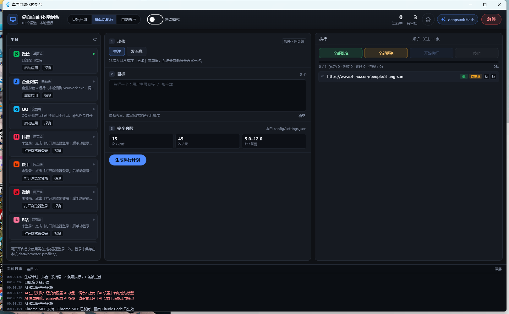
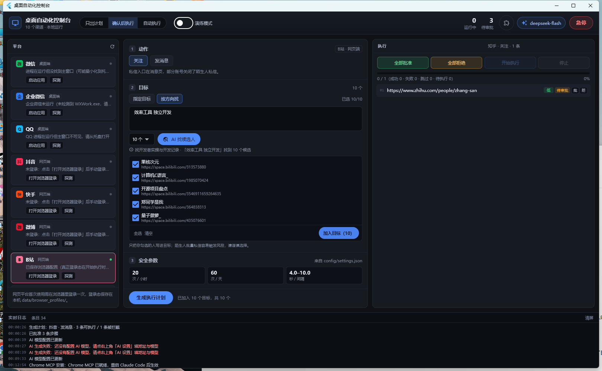
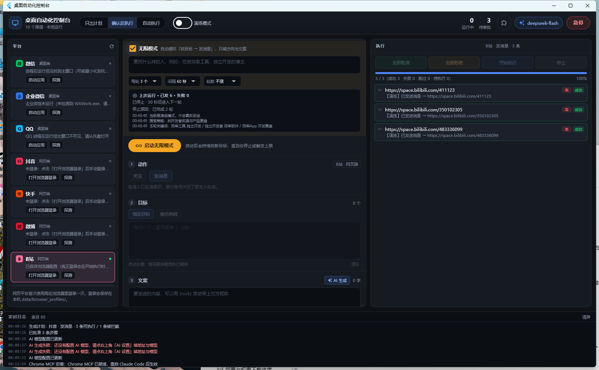

# 桌面自动化控制台

一个跑在本机的社交自动化工作台：在 **微信 / 企业微信 / QQ / 抖音 / 快手 / 微博 / B站 / 小红书 / 知乎 / 贴吧**
十个渠道上发消息、加好友、加群、关注。

它不是「一键群发器」——默认每一步都要人批准，所有动作都有频率上限、去重窗口和审计日志。



## 特性

- **十个渠道**：3 个桌面端（UI Automation + 剪贴板）+ 7 个网页端（Playwright + 本机 Chrome）。
- **人工审批**：计划里的步骤必须批准才会执行；MCP 工具无法自行批准。
- **按方向找人**：写一句「想找什么样的人」，AI 转成搜索词，程序抓候选，你勾选后才进入计划。
- **自动留言**：七个网页平台支持在作品/帖子下留言，进页后自动滚到评论区、提交并校验是否出现。
- **关注后再发送**：七个网页平台可勾选「关注后再发送」，先关注目标再发私信；一步做两次平台操作，
  间隔会自动放慢 1.5 倍。桌面端（微信/企业微信/QQ）没有这个概念，不显示该选项。
- **无限模式**：只填方向与文案，循环执行「找目标 → 生成计划 → 审批 → 执行 → 冷却」，直到你停或触发上限。
- **AI 巡检员**：每次没进展（搜不到、计划失败、页面卡住）都会把诊断交给模型判断，从
  `重试 / 换关键词 / 重置浏览器 / 等待 / 停止` 里选一个；AI 连续失效或关键词试尽会主动收手，不会空转。
- **AI 设置**：任意 OpenAI 兼容接口，填完地址和 Key 自动拉模型列表，思考深度四档。
- **Chrome MCP 一键安装**：给 Claude Code 装浏览器操作能力，装完做真实握手验证。
- **可被 Claude 驱动**：本机 MCP 服务把能力暴露成工具，配合 `skills/` 里的技能使用。

> **关于「加好友」和「加群」**：只有 **QQ** 能自动化——搜号码→加好友、搜群号→申请加群。
> 微信/企业微信的加好友只能扫码、手机号或邀请，没有可自动化的入口；微信群必须靠邀请或二维码。
> 网页平台没有「好友」概念，等价物是「关注」。**留言**则是七个网页平台都支持。

| 按方向找人 | 无限模式 |
|---|---|
|  |  |

## 快速开始

前置：Windows 10/11、Python 3.11+、Node.js 18+、本机已装 Chrome 或 Edge。

```powershell
pip install -r requirements.txt

# 启动后端 + 网页版界面
python -m app.server --open
```

浏览器打开 http://127.0.0.1:18765 即可。

### 桌面应用（Flutter，可选）

```powershell
# 需要 Flutter SDK 与 Visual Studio 2022（含 C++ 桌面开发）
powershell -ExecutionPolicy Bypass -File scripts\build_flutter.ps1
launch_app.bat
```

### 接入 Claude Code（可选）

```powershell
pip install windows-mcp          # 桌面操作 MCP
npm i -g @playwright/mcp         # 浏览器操作 MCP
python scripts\register_mcp.py   # 写入 ~/.claude.json
claude mcp list                  # 四个服务应全部 Connected
```

技能在 `skills/`，复制到 `~/.claude/skills/` 即可被 Claude Code 加载。

## 使用流程

1. 左侧选平台 →「打开浏览器登录」或「启动应用」，手动完成登录（登录态存在本地）。
2. 中间填目标（或切「按方向找」让 AI 找候选）、写文案。
3. 生成计划 → 右侧看拦截原因 → 批准 → 执行。

想省事就勾「无限模式」：只填方向和文案，剩下的交给循环。

## 安全机制

| 机制 | 说明 |
|---|---|
| 审批门 | 未批准的步骤永不执行；MCP 不能自行批准 |
| 频率上限 | 每平台每小时/每天硬上限，执行前二次核对 |
| 去重窗口 | 同一目标 7 天内不重复触达 |
| 域名白名单 | 网页平台只允许跳转自己的域名 |
| 自动熔断 | 连续 3 轮全失败 / 5 轮无新目标 / 未登录 都会停 |
| 急停 | 一键中止所有任务与新任务 |
| 审计 | 每条动作写 SQLite + 截图存 `data/screenshots/` |

## 架构

```
app/
├─ server.py        FastAPI：/api/*（计划、审批、执行、AI、发现、无限模式、环境）
├─ engine.py        计划 → 审批 → 限速执行
├─ autopilot.py     无限模式循环
├─ guard.py         去重 / 限流 / 风险分级 / 文案体检
├─ ai.py            OpenAI 兼容调用、关键词生成、模型列表
├─ store.py         SQLite（任务、步骤、事件、联系人）
├─ mcp_server.py    stdio MCP（给 Claude Code）
├─ setup_tools.py   Chrome MCP 一键安装
└─ adapters/        十个平台适配器（web_common 提供浏览器基类）
flutter_app/        Flutter 桌面界面
web/                网页版界面（备用）
scripts/            构建、自检、探测脚本
```

## 开发

```powershell
python scripts\mcp_smoke.py      # MCP 协议与安全约束自检
python scripts\e2e_ui.py         # 网页版端到端
python scripts\mock_openai.py    # 本地假接口，没 Key 也能验证 AI 功能
flutter analyze && flutter test  # 桌面端
```

## 免责声明

自动加好友、批量私信、自动关注在多数平台的服务条款里是**明确限制**的，高频操作会导致限流、封号，
也可能触及《个人信息保护法》《反电信网络诈骗法》。

请只用于**你明确知道对方是谁**的联络、社群内部通知、自己账号的日常维护。
不要做陌生人营销群发、刷量、导流。使用者需自行承担账号与合规风险。

## License

[MIT](LICENSE)
